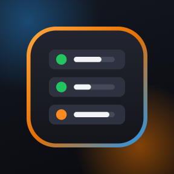
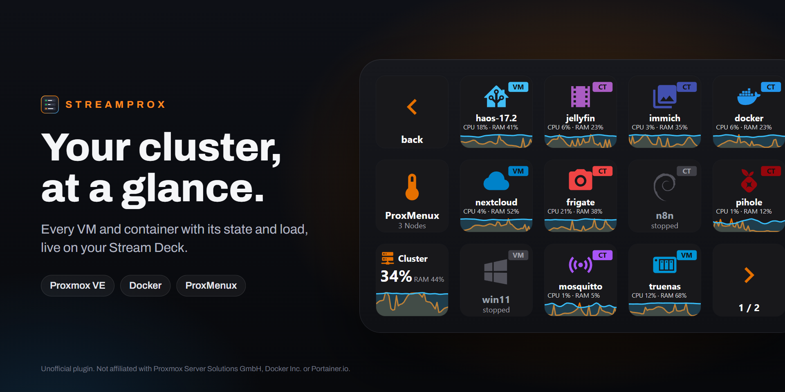
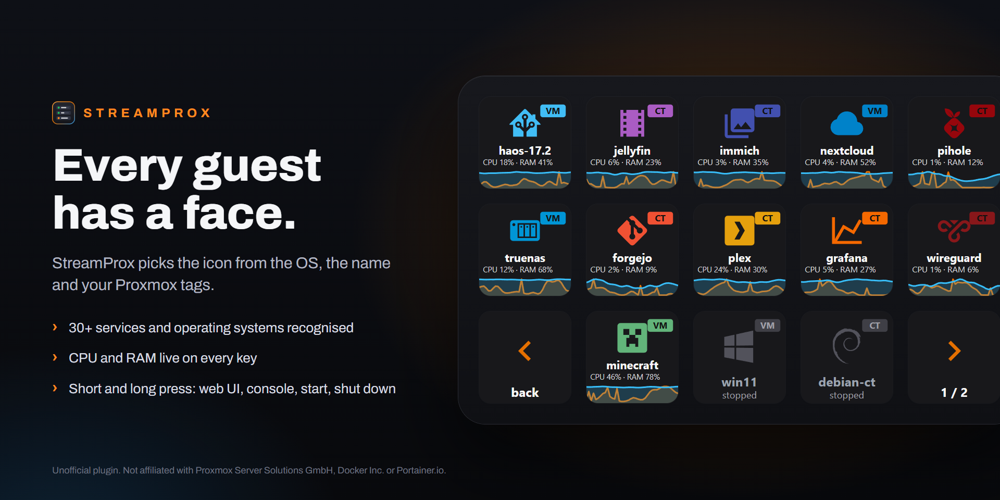
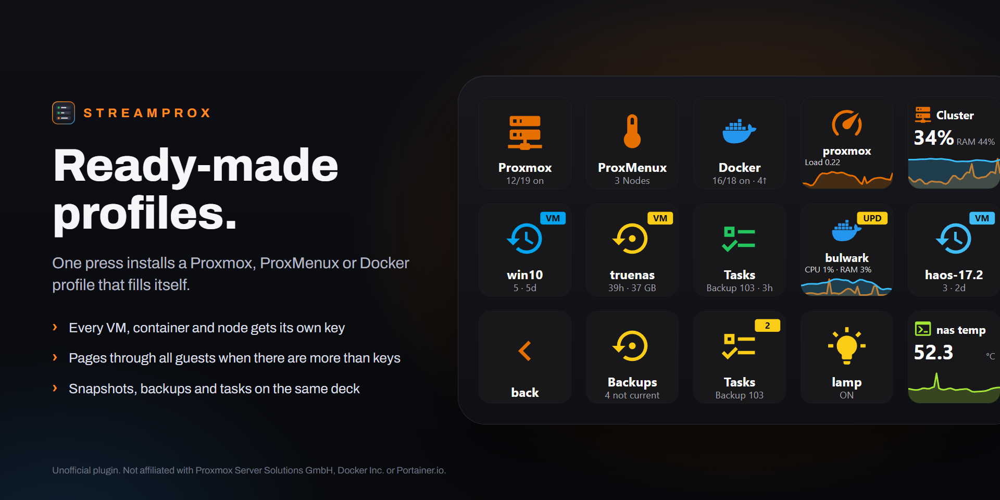
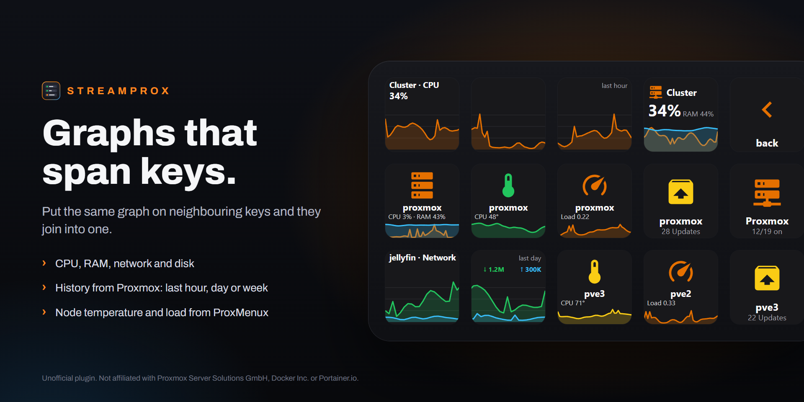
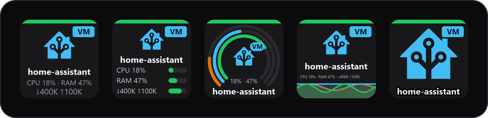
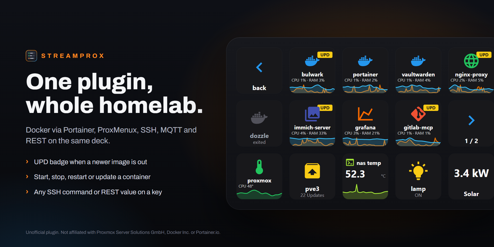
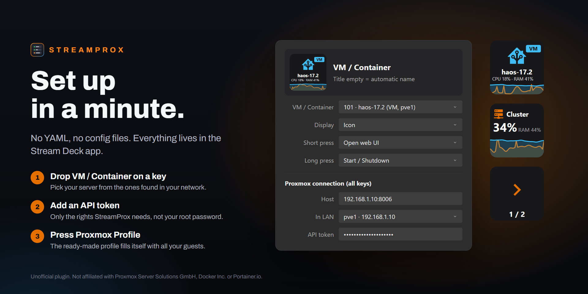

  

<h1 align="center">StreamProx</h1>

  <b>Proxmox VE, Docker and ProxMenux on your Stream Deck.</b> 
  Every VM and container gets a live key. Start, stop and watch your homelab without opening a browser.

  <a href="https://marketplace.elgato.com/product/streamprox-17149f67-b70e-453c-b242-dfdf07502794"><b>Get StreamProx on the Elgato Marketplace</b></a>
  ·
  <a href="https://marketplace.elgato.com/@stefanknaak">More from Stefan Knaak</a>
  ·
  <a href="../../issues/new/choose">Report a bug or request a feature</a>

  <a href="#english">English</a> · <a href="#deutsch">Deutsch</a>

> This repository is the home page of StreamProx: description, screenshots and the issue tracker. The plugin itself is distributed through the Elgato Marketplace.

---

## English

StreamProx shows your Proxmox VE cluster live on the Stream Deck. Each VM and LXC container gets its own key with state, CPU, RAM and network, and a press starts it, shuts it down or opens its console. Docker containers from Portainer, node values from ProxMenux, SSH commands, MQTT and REST calls live on the same deck.

### Every guest has a face

- StreamProx picks the icon from the operating system, the name and your Proxmox tags. Running guests show in colour, stopped ones in grey.
- Optional app logos for 2,900+ self-hosted apps (Jellyfin, Immich, Nextcloud, Home Assistant and more).
- Short and long press carry separate actions: web UI, console, start, shutdown, reboot, hard stop, pause.
- "Start, shut down the others first" for nodes with little RAM, with a list of guests that keep running.

### Ready-made profiles

Drag **Proxmox Profile** onto a key and press it. Stream Deck asks whether to install the profile; confirm. The profile fills itself with all your VMs and containers and pages through them when you have more guests than keys. The same action opens a ProxMenux profile and a Docker profile.

Snapshots (create, roll back, delete), backups (age, size, back up now) and a task monitor for running and failed Proxmox tasks sit on the same deck.

### Graphs that span keys

Put the Wide Graph action on two to five neighbouring keys with the same settings and they join into one graph. CPU, RAM, network and disk, with history straight from Proxmox for the last hour, day or week. ProxMenux adds node temperature, load and pending updates.

### Your look

Show load as text, bars, gauge or mini graph, or let the icon fill the whole key. Choose CPU, RAM, network or any mix, scale text and icons from 80 to 150 %, and set it for all keys at once or per key.

### One plugin, whole homelab

- **Docker via Portainer:** all containers of all environments, a yellow UPD badge when a newer image is out, start, stop, restart or update with a key.
- **ProxMenux Monitor:** temperature with history, load and updates per node, found automatically.
- **SSH, MQTT, REST:** any command or value on a key, with a live status and graph.

### Set up in a minute

1. Install StreamProx from the [Elgato Marketplace](https://marketplace.elgato.com/product/streamprox-17149f67-b70e-453c-b242-dfdf07502794).
2. Drag **VM / Container** onto a key. Pick your server under **In LAN** or type `host:8006`, then add an API token.
3. Drag **Proxmox Profile** onto a key, press it and confirm the installation.

Create the API token in Proxmox under **Datacenter → Permissions → API Tokens**. StreamProx shows a direct link there until it is connected. For Docker, create an access token in Portainer under **My account → Access tokens**.

### Requirements

- Stream Deck app 7.1 or newer on Windows 10+ or macOS 12+
- Proxmox VE with an API token (tested with 9.2)
- Optional: Portainer 2.x with an access token, ProxMenux Monitor

### Good to know

- The ready-made profiles fit the 15-key Stream Deck (MK.2). On other models you place the keys yourself.
- Give StreamProx an API token limited to the rights it needs instead of the root password. Stream Deck stores plugin settings unencrypted.
- App logos are off by default. Turned on, StreamProx looks up app names on selfh.st and caches every logo locally.
- English and German, following the Stream Deck language or your choice in the settings.

### Feedback

Found a bug or missing a feature? [Open an issue](../../issues/new/choose). Questions are welcome there too.

---

## Deutsch

StreamProx zeigt deinen Proxmox-VE-Cluster live auf dem Stream Deck. Jede VM und jeder LXC-Container bekommt eine eigene Taste mit Zustand, CPU, RAM und Netzwerk, und ein Druck startet sie, fährt sie herunter oder öffnet die Konsole. Docker-Container aus Portainer, Werte aus ProxMenux, SSH-Befehle, MQTT und REST-Aufrufe laufen auf demselben Deck.

### Jeder Gast hat ein Gesicht

- StreamProx wählt das Icon nach Betriebssystem, Name und deinen Proxmox-Tags. Laufende Gäste erscheinen farbig, gestoppte grau.
- Optional App-Logos für über 2.900 selbst gehostete Apps (Jellyfin, Immich, Nextcloud, Home Assistant und mehr).
- Kurzer und langer Druck haben eigene Funktionen: Web-UI, Konsole, Start, Shutdown, Reboot, harter Stopp, Pause.
- „Start, vorher die anderen aus“ für Nodes mit wenig RAM, mit einer Liste von Gästen, die weiterlaufen sollen.

### Fertige Profile

Zieh **Proxmox-Profil** auf eine Taste und drück sie. Stream Deck fragt, ob das Profil installiert werden soll; bestätige das. Das Profil füllt sich selbst mit allen VMs und Containern und blättert, wenn du mehr Gäste als Tasten hast. Dieselbe Aktion öffnet auch ein ProxMenux- und ein Docker-Profil.

Snapshots (erstellen, zurücksetzen, löschen), Backups (Alter, Größe, jetzt sichern) und ein Task-Monitor für laufende und fehlgeschlagene Proxmox-Aufgaben laufen auf demselben Deck.

### Graphen über mehrere Tasten

Leg die Aktion „Breiter Graph“ auf zwei bis fünf nebeneinanderliegende Tasten mit gleichen Einstellungen, dann verbinden sie sich zu einem Graphen. CPU, RAM, Netzwerk und Disk, mit Verlauf direkt aus Proxmox für die letzte Stunde, den letzten Tag oder die letzte Woche. ProxMenux liefert dazu Temperatur, Last und offene Updates pro Node.

### Dein Look

Last als Text, Balken, Gauge oder Mini-Graph, oder das Icon füllt die ganze Taste. Wähle CPU, RAM, Netzwerk oder eine Kombination, skaliere Schrift und Icons von 80 bis 150 % und stell alles für alle Tasten auf einmal oder pro Taste ein.

### Ein Plugin, das ganze Homelab

- **Docker über Portainer:** alle Container aller Umgebungen, ein gelbes UPD-Badge bei neuerem Image, Start, Stopp, Neustart oder Update per Taste.
- **ProxMenux Monitor:** Temperatur mit Verlauf, Last und Updates pro Node, automatisch gefunden.
- **SSH, MQTT, REST:** jeder Befehl oder Wert auf einer Taste, mit Live-Status und Graph.

### In einer Minute eingerichtet

1. StreamProx aus dem [Elgato Marketplace](https://marketplace.elgato.com/product/streamprox-17149f67-b70e-453c-b242-dfdf07502794) installieren.
2. **VM / Container** auf eine Taste ziehen. Den Server unter **Im Netz** auswählen oder `host:8006` eintragen, dann einen API-Token hinzufügen.
3. **Proxmox-Profil** auf eine Taste ziehen, drücken und die Installation bestätigen.

Den API-Token legst du in Proxmox unter **Rechenzentrum → Berechtigungen → API-Token** an. StreamProx zeigt dorthin einen direkten Link, solange keine Verbindung besteht. Für Docker legst du in Portainer unter **My account → Access tokens** einen Access-Token an.

### Voraussetzungen

- Stream-Deck-App 7.1 oder neuer unter Windows 10+ oder macOS 12+
- Proxmox VE mit API-Token (getestet mit 9.2)
- Optional: Portainer 2.x mit Access-Token, ProxMenux Monitor

### Gut zu wissen

- Die fertigen Profile passen auf das Stream Deck mit 15 Tasten (MK.2). Auf anderen Modellen setzt du die Tasten selbst.
- Gib StreamProx statt des root-Passworts einen API-Token mit den nötigen Rechten. Stream Deck speichert Plugin-Einstellungen unverschlüsselt.
- App-Logos sind standardmäßig aus. Eingeschaltet sucht StreamProx die App-Namen bei selfh.st und speichert jedes Logo lokal.
- Englisch und Deutsch, passend zur Stream-Deck-Sprache oder nach deiner Wahl in den Einstellungen.

### Feedback

Fehler gefunden oder fehlt dir eine Funktion? [Leg ein Issue an](../../issues/new/choose). Fragen sind dort auch willkommen.

---

  Unofficial plugin. Not affiliated with Proxmox Server Solutions GmbH, Docker Inc., Portainer.io or the ProxMenux project. 
  Inoffizielles Plugin, nicht verbunden mit der Proxmox Server Solutions GmbH, Docker Inc., Portainer.io oder dem ProxMenux-Projekt.

